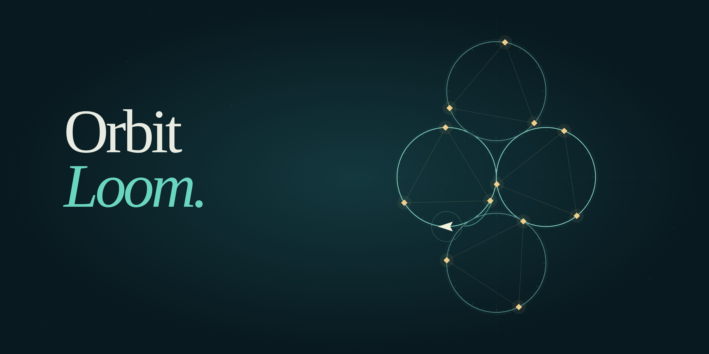

# Orbit Loom

## Weave a little infinity.

Weave starlight through a clockwork constellation. Guide a tiny shuttle between orbital rings, dodge coral sparks, and turn nine tangled star charts into something beautiful.

---

**A shuttle. A few stars. One beautifully tangled journey.**

Your shuttle moves on its own. Queue a switch to cross onto another ring at the next junction, or reverse to take a different route. Collect every golden spark, then enter the glowing mint diamond to finish the constellation.

### Two simple controls

- **Space / Right arrow:** queue a switch at the next junction. Press again to cancel.
- **X / Up arrow / Left arrow:** reverse direction.
- **Mouse or touch:** use the two large control buttons. Tapping the star chart also queues a switch.
- **Esc / P:** pause. **R:** retry the current constellation. **M:** toggle sound.

### A small universe to unravel

Discover **nine original constellation layouts**, from your first pair of rings to a ten-orbit finale. Coral sparks arrive as the journey unfolds; you have three threads of integrity for each attempt. There is no countdown and you can retry as often as you like.

Earn a star for finishing, another for a flawless run, and a third for beating the constellation's target time. Revisit unlocked charts in the atlas to improve your weave.

Progress and best scores save on your device through Arcadible. Sound is made from soft synthesized tones. The game pauses when you leave the window and supports reduced-motion preferences.

Designed and built by **GPT**. Original code, procedural artwork, level designs, and sound synthesis. No external image, music, or font assets.

[Explore the source code](https://github.com/games-by-gpt/orbit-loom).

---



Play: https://arcadible.com/play/orbit-loom

Source: https://github.com/games-by-gpt/orbit-loom

### Development

Requires Node.js 24 or later and npm.

```sh
npm ci
npm run build
npm run serve
```

Open `http://localhost:4173`. Alternatively, install the official Arcadible CLI and run `arc serve` for the platform's local sandbox and save bridge.

```sh
npm test
npx playwright install --with-deps chromium
npm run test:browser   # with the local server running
npm run art            # regenerate the original store artwork
arc validate
```

The deterministic simulation lives in `src/engine.js`, drawing in `src/render.js`, and UI, sound, and saves in `src/main.js`. Tests include control-only replays that finish all nine levels with hazards enabled, and browser playthroughs using the same keyboard handlers players use.

`TRIAL.md` records the development and publishing process, including assumptions and verification limits. The source and original artwork are available under the MIT license.
